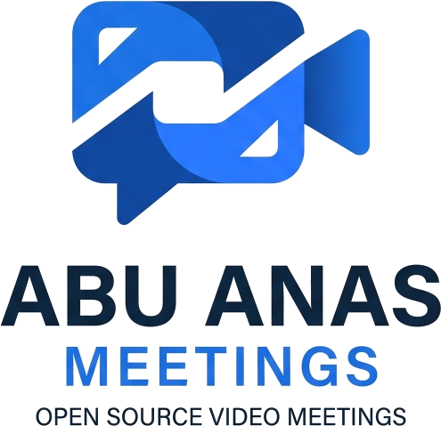
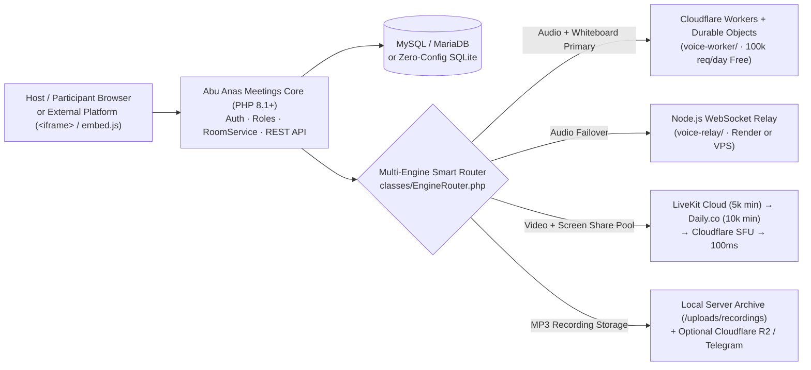

<div align="center">
  

  <h1>أبو أنس ميتينجز | Abu Anas Meetings</h1>
  <p>
    <strong>منصة اجتماعات فيديو وصوت مفتوحة المصدر ومجانية — بديل ذاتي الاستضافة وخفيف لـ Jitsi Meet</strong><br />
    <em>Open-Source Self-Hostable & Embeddable Video/Audio Meetings Platform with Multi-Engine Smart Routing</em>
  </p>

  <p>
    <a href="https://liveservice.5dmaty.com"></a>
    
    
    
    
  </p>
</div>

---

## نظرة عامة | Overview

**أبو أنس ميتينجز (Abu Anas Meetings)** هي منصة اجتماعات وبث تفاعلي مفتوحة المصدر صُممت لتعمل **كخدمة مستقلة بالكامل** (مثل Jitsi Meet / Zoom) **وكوحدة قابلة للتضمين** داخل أي موقع أو أكاديمية أو نظام إدارة تعلم (LMS) أو منصة SaaS بسطر كود واحد.

تجمع المنصة بين **سهولة التشغيل على أي استضافة PHP** (بقاعدة بيانات **MySQL** أو **SQLite صفرية الإعداد**) وبين **موزّع محركات ذكي (Multi-Engine Smart Router)** يدمج الباقات السحابية المجانية معاً ويبدّل بينها تلقائياً بدون إظهار أي تفاصيل تقنية للمستخدمين أو المضيفين.

> **Live Instance / النسخة المباشرة:** [https://liveservice.5dmaty.com](https://liveservice.5dmaty.com)

---

## البنية المعمارية | System Architecture



---

## المميزات الأساسية | Key Features

| الميزة | الوصف |
| :--- | :--- |
| **أدوار وحسابات متكاملة** | حسابات **مضيف (`host`)** (مع خيار التسجيل المباشر كمضيف أو الترقية بضغطة واحدة مجاناً)، حسابات **مشاركين (`member`)**، و**دخول الضيوف** بالاسم فقط، ولوحة **مدير النظام (`admin`)**. |
| **التضمين الخارجي مثل Jitsi** | تضمين مباشر عبر `<iframe>`، أو مكتبة JavaScript خفيفة (`assets/js/embed.js` عبر `new AbuAnasMeetings(...)`)، مع دعم أحداث `postMessage` (`joined`, `count`, `left`, `ended`) ومفاتيح `X-API-KEY` لإنشاء الغرف برمجياً عبر `POST /api/external_room.php`. |
| **غرف تفاعلية شاملة** | بث صوتي عالي النقاء (WebCodecs Opus 48kHz + ADPCM16 fallback)، فيديو ومشاركة شاشة، **سبورة تفاعلية متزامنة** مع عرض شرائح (PNG/JPG/WEBP)، دردشة مباشرة مع تمييز الأسئلة وتثبيتها، واستطلاعات تصويت حية. |
| **تسجيل MP3 مدمج** | تسجيل الجلسة مباشرة من المتصفح بصيغة MP3 وحفظها تلقائياً في مكتبة التسجيلات مع دعم النشر السحابي الاختياري عبر R2 أو Telegram. |
| **واجهة نظيفة تدعم العربي والإنجليزي** | تصميم RTL حديث بالوضعين الفاتح والداكن (`light` / `dark`) خالٍ تماماً من المصطلحات التقنية المعقدة أمام المضيف والجمهور. |
| **مراقبة وموزّع ذكي للإدارة** | لوحة إدارة خاصة (`admin/providers.php`, `admin/monitor.php`, `admin/users.php`) لمراقبة البينج، الحصص الشهرية، والأولويات بين المحركات تلقائياً. |

---

## الدمج السريع في منصاتك | Embed & API Integration

### 1. عبر HTML `<iframe>`
```html
<iframe
  src="https://liveservice.5dmaty.com/room.php?code=YOUR_CODE&embed=1&name=GuestName&theme=light"
  allow="camera; microphone; display-capture; autoplay; clipboard-write"
  allowfullscreen
  style="width:100%;height:680px;border:0;border-radius:16px;">
</iframe>
```

### 2. عبر JavaScript SDK (`embed.js` — بأسلوب Jitsi API)
```html
<div id="meeting-box"></div>
<script src="https://liveservice.5dmaty.com/assets/js/embed.js"></script>
<script>
  const meet = new AbuAnasMeetings('#meeting-box', {
    baseUrl: 'https://liveservice.5dmaty.com',
    roomCode: 'YOUR_CODE',
    userName: 'أنس محمد',
    theme: 'light',
    height: '650px',
    onEvent: (ev) => console.log('Meeting event:', ev)
  });
</script>
```

### 3. إنشاء الغرف تلقائياً من السيرفر (`POST /api/external_room.php`)
أنشئ مفتاح ربط مجاني من صفحة `/embed.php` بعد تسجيل الدخول كمضيف، ثم استدعِ:

```bash
curl -X POST https://liveservice.5dmaty.com/api/external_room.php \
  -H "Content-Type: application/json" \
  -H "X-API-KEY: aam_live_your_api_key_here" \
  -d '{
    "title": "جلسة مراجعة المشروع",
    "preset": "meeting",
    "media_mode": "video",
    "access_mode": "public",
    "whiteboard_enabled": true
  }'
```

**الاستجابة (`201 Created`):**
```json
{
  "success": true,
  "id": 12,
  "code": "8XK9P2",
  "join_url": "https://liveservice.5dmaty.com/room.php?code=8XK9P2",
  "embed_url": "https://liveservice.5dmaty.com/room.php?code=8XK9P2&embed=1"
}
```

---

## التثبيت والتشغيل | Installation & Deployment

### المتطلبات | Requirements
- **Web Server / PHP:** PHP 8.1+ with `pdo_mysql` or `pdo_sqlite`, `curl`, `mbstring`, `openssl`.
- **Realtime Audio Engine (اختياري/أساسي أونلاين):** Node.js 18+ (لـ `voice-worker/` على Cloudflare Workers أو `voice-relay/` محلياً/Render).

### 1. التشغيل على استضافة مشتركة (SQLite صفرية الإعداد — مثل Hostinger)
1. انسخ ملف `.env.example` إلى `.env` واضبط:
   ```env
   APP_ENV=production
   SITE_URL=https://your-domain.com
   DB_DRIVER=sqlite
   DB_SQLITE_PATH=database/abuanas.sqlite
   JWT_SECRET=your-64-char-random-hex-secret
   CF_WORKER_WS_URL=wss://your-worker.your-subdomain.workers.dev
   ```
2. تأكد من صلاحية الكتابة على المجلدات `database/` و `uploads/recordings/` و `uploads/slides/`.
3. افتح الموقع في المتصفح؛ يقوم النظام تلقائياً بإنشاء الجداول من `database/schema_sqlite.sql` وحسابات البداية!

### 2. التشغيل المحلي (XAMPP + MySQL)
1. ضع المشروع داخل `htdocs/abuanas-meetings` وأنشئ `.env` بإعدادات MySQL (`DB_DRIVER=mysql`, `DB_NAME=abuanas_meetings`).
2. شغّل سيرفر الصوت المحلي `voice-relay/`:
   ```bash
   cd voice-relay
   npm install
   node server.js
   ```
3. افتح `http://localhost/abuanas-meetings/` في المتصفح.

### 3. نشر محرك الصوت على Cloudflare Workers (`voice-worker/`)
```bash
cd voice-worker
npm install
npx wrangler deploy
npx wrangler secret put JWT_SECRET
```
استخدم نفس `JWT_SECRET` الموجود في `.env` بالمنصة ثم أضف رابط `wss://...workers.dev` في `CF_WORKER_WS_URL` أو من لوحة `/admin/providers.php`.

> **تنبيه أمني هام بعد التثبيت:** غيّر كلمات مرور الحسابات الافتراضية (`admin@abuanas.local` / `host@abuanas.local`) فوراً من قاعدة البيانات أو حسابات جديدة بعد النشر الأول على أي سيرفر إنتاجي.

---

## هيكل المشروع | Project Structure

```
abuanas-meetings/
├── admin/                  # لوحة المدير (providers.php, monitor.php, users.php)
├── api/                    # واجهات API (external_room.php, room_token.php, room_state.php, ...)
├── assets/
│   ├── css/                # app.css (الهوية العامة), room.css (واجهة الغرفة المستقلة)
│   ├── images/             # logo-full.png, logo-mark.png, favicon.png
│   └── js/                 # embed.js (SDK), room-app.js, audio-engine.js, engine-adapters.js, whiteboard.js
├── classes/                # Auth, EngineRouter, RoomService, RecordingPublisher
├── config/                 # config.php (Env, URLs, Cookies, JWT), database.php (MySQL + SQLite PDO)
├── database/               # schema.sql (MySQL), schema_sqlite.sql (SQLite)
├── includes/               # header.php, footer.php
├── uploads/                # recordings/, slides/ (مع الحفاظ على .gitkeep)
├── voice-relay/            # Node.js WebSocket Relay (بديل احتياطي لـ Render / المحلي)
├── voice-worker/           # Cloudflare Workers + Durable Objects Signaling & Audio Mesh
├── .env.example            # قالب متغيرات البيئة (بدون أسرار)
├── .htaccess               # حماية .env و database/ والملفات الحساسة + سماح التضمين
├── dashboard.php           # لوحة المضيف والمشارك وإنشاء الغرف
├── embed.php               # بوابة التضمين وتوليد مفاتيح X-API-KEY
├── index.php               # الصفحة الرئيسية واستعراض الاجتماعات العامة
├── login.php / register.php / logout.php
└── room.php                # شاشة الاجتماع المستقلة والمدمجة (100dvh x 100vw)
```

---

## الترخيص | License

هذا المشروع مرخص بموجب رخصة **MIT License** — انظر ملف [LICENSE](LICENSE).
